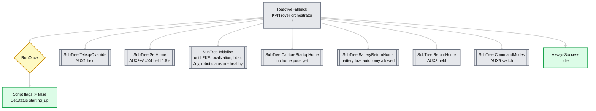
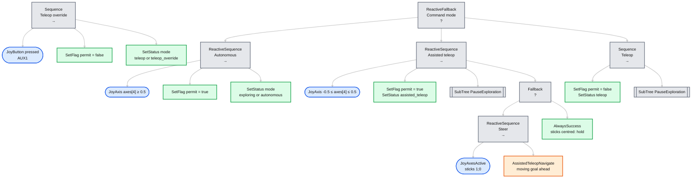
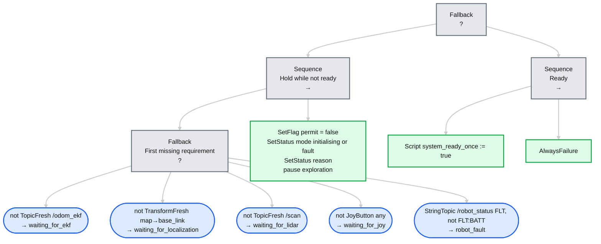
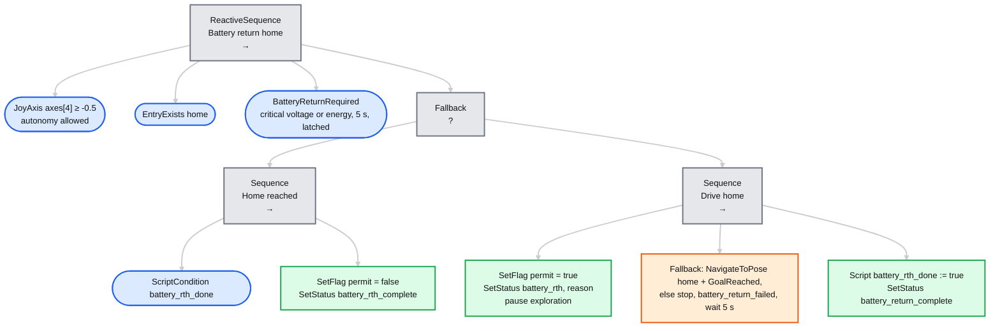
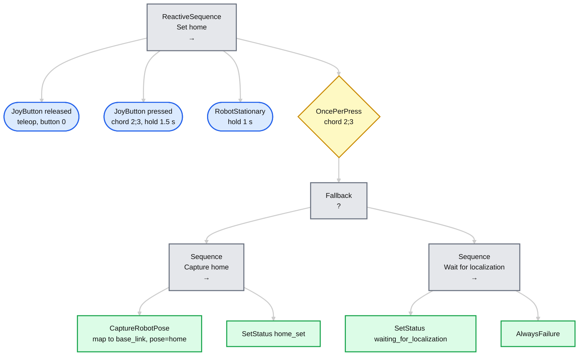
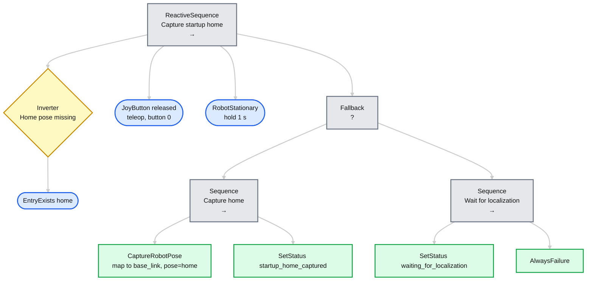
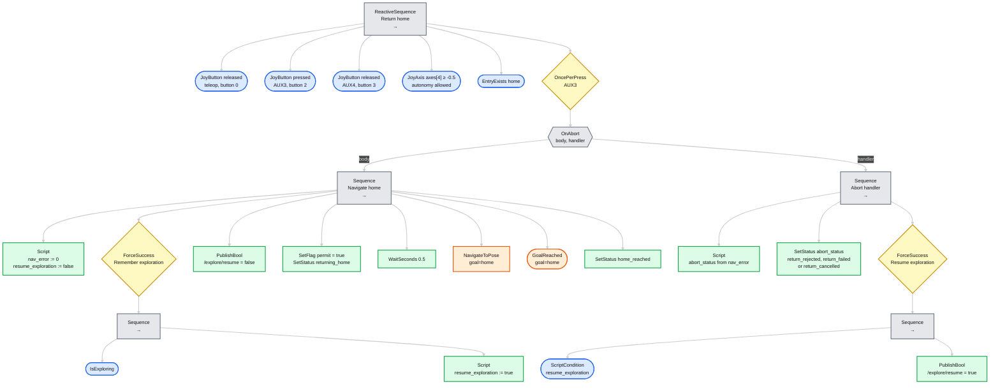

# kvn_orchestrator

A [BehaviorTree.CPP](https://www.behaviortree.dev/) (v4) orchestrator for the rover's autonomous
functions, built on the Nav2 BT API. The behaviour is defined entirely in XML: which subtrees exist,
their priority, and every topic, button index, timeout and threshold. Node implementations are
plugins loaded by name, so adding a new action means writing a plugin and referencing it from XML.

Navigation is done by Nav2's own `NavigateToPose` and `GoalReached` BT plugins
(`nav2_behavior_tree`). The orchestrator is a `nav2::LifecycleNode` that provides the blackboard
entries those plugins expect (`node`, `tf_buffer`, `bt_loop_duration`, timeouts), so any other Nav2
BT plugin (`Spin`, `BackUp`, `Wait`, ...) can be added to `plugin_libraries` and used from XML.

The shipped tree selects the rover's command mode, gates autonomy behind an initialisation and
safety check, provides assisted teleoperation through Nav2, captures a home pose and returns home
on request or when the battery runs low. A second tree drives the signalling light.

## Controls and safety

- **Command mode**: 3-position switch on AUX5 (`/joy.axes[4]`, CRSF channel 8):
  low = `teleop`, middle = `assisted_teleop`, high = `autonomous` (Nav2 accepts goals from
  explore_lite, Foxglove/RViz or scripts). On RC link loss the receiver's failsafe puts it in the
  middle: assisted teleop with centred sticks, i.e. standing still.
- **Operator override**: holding AUX1 (`buttons[0]`) drives from the sticks in every mode. The
  override is done by the teleop node (`kvn_joy_teleop`, running as `teleop_twist_joy_node`), not
  here: it is the only `/cmd_vel` publisher and forwards Nav2's `/cmd_vel_auto` only while AUX1
  is released, Joy is alive and `/orchestrator/autonomy_enabled` is true and fresh. This tree sets
  that permit; holding AUX1 also suspends the active branch (cancelling its Nav2 goal), which
  resumes on release.
- **Initialisation and safety**: no autonomy until `/odom_ekf`, localization (`map` ->
  `base_link`), `/scan` and `/joy` are fresh and `/robot_status` has no fault other than battery.
  The first missing item is reported on `/orchestrator/status`; the mode is `initialising` until
  everything has been healthy once, `fault` if something is lost later.
- **Assisted teleop**: with the sticks deflected, Nav2 drives to a goal placed up to 1.5 m ahead in
  the direction the operator steers (up to 90° to either side) and moves it as the rover and the
  sticks move, so Nav2 plans around obstacles. Centred sticks cancel the goal and the rover stops.
  Backward stick is ignored (the controller does not reverse); a pure sideways stick turns on the
  spot.
- **Battery return home**: in `assisted_teleop` or `autonomous` mode, when the pack voltage is at
  or below `battery.critical_voltage`, or the energy left (from the voltage curve) is no more than
  `distance_home × path_factor × wh_per_m + reserve_wh` (all in `kvn_robot_bringup/config/robot.yaml`),
  for 5 s, the rover drives home and then stays there (mode `battery_rth_complete`) until the
  orchestrator restarts. In `teleop` mode it never moves on its own: the light and handset show
  the battery state.
- At startup, the first localized pose is captured as home after `/odom_ekf`
  reports the rover stationary for one second and teleop is disabled.
- Hold AUX3 (`/joy.buttons[2]`) by itself, with the mode switch on assisted or autonomous, to pause
  active exploration and navigate to home. Releasing AUX3, enabling teleop, losing fresh Joy
  messages or switching to teleop mode cancels the Nav2 goal (Nav2's BT node waits for Nav2 to
  confirm the cancellation).
- If exploration was active before return-home, cancelling the return resumes
  exploration. Successfully reaching home leaves exploration paused.
- Hold AUX3+AUX4 (`buttons[2]` and `[3]`) for 1.5 seconds to capture a replacement
  home pose. This is allowed only with teleop disabled and the rover stationary.
- Home is kept in memory (on the blackboard) and captured again after process restart.

## Tree overview

Diagrams of the shipped XML in [`trees/`](trees), using the standard behavior-tree notation. Keep them
in sync when you edit the XML.

| Node type | Symbol | Meaning |
| --- | --- | --- |
| Fallback / Selector | box with `?` | Runs children left to right; succeeds if any child succeeds |
| Sequence | box with `→` | Runs children left to right; succeeds only if all succeed |
| Condition | ellipse | Checks a true/false state |
| Action | box | A task; green, or orange when it is one of Nav2's own plugins |
| Decorator | diamond | Changes the result or timing of its single child |
| `OnAbort` | hexagon | Not standard. Two children: body, then handler if the body fails or is halted |
| `SubTree` | double-bordered box | Not standard. Reference to another tree, expanded in its own diagram |

Symbols follow Colledanchise and Ögren (reference 1). Mermaid has no true ellipse, so conditions
use its closest shape, the stadium.

The reactive variants (`ReactiveFallback`, `ReactiveSequence`) re-check their children every tick,
so a guard going false halts a running child.

### Legend


### Top level (`kvn_orchestrator.xml`)



### `TeleopOverride` and `CommandModes` (`subtrees/modes.xml`)

`TeleopOverride` succeeds while AUX1 is held, which suspends every lower branch. `CommandModes`
always succeeds; its last branch is plain teleop. `PauseExploration` publishes
`/explore/resume = false` if explore_lite reports that it is exploring.



### `Initialise`

Succeeds (holding back every lower branch) while a requirement is missing; fails once all are met.



### `BatteryReturnHome`



### Signalling (`signalling.xml`)

A separate tree, ticked next to the main one from startup (it needs no Nav2 server, so the light
works while Nav2 is still coming up). It publishes one signal, latched, on `/orchestrator/signal`;
`kvn_wled_signal` shows it. Priority: `battery_critical` (voltage or `FLT:BATT`), `fault` (any
other `FLT`, or `/robot_status` silent), `battery_low`, `warning`, then from the mode:
`returning_home`, `exploration`, `navigation`, `assisted_teleop`; `teleop` while AUX1 is held;
`warning` for mode `fault`; `starting_up`; otherwise `standby`.

### `SetHome`



### `CaptureStartupHome`

Same capture fallback as `SetHome`, but it only runs while no home pose exists and has no chord or
latch.



### `ReturnHome`

The guards run every tick. If one goes false while the body is running, `OnAbort` halts the body,
which makes Nav2's node cancel the goal, and then runs the handler.



## Configuration

| What | Where |
| --- | --- |
| Tree shape, priorities, topics, buttons, timeouts, thresholds, status texts | [`trees/`](trees) XML |
| Plugin libraries, tick period, heartbeat, which XML files/tree to run | [`config/orchestrator.yaml`](config/orchestrator.yaml) |
| Battery limits and return-home energy model (`{battery_*}` in the XML) | `kvn_robot_bringup/config/robot.yaml`, passed by `nav_stack.launch.py` as `blackboard.*` parameters; defaults in `orchestrator.yaml` |
| Skip the `/robot_status` checks (simulation) | `require_robot_status:=false` (launch) |
| Alternative signalling XML, or none | `signalling_tree:=/path/to/tree.xml` or `signalling_tree:=''` |
| Settings Nav2's BT nodes read from node parameters (`goal_reached_tol`, timeouts) | [`config/orchestrator.yaml`](config/orchestrator.yaml) |
| Alternative XML at launch | `orchestrator_tree:=/path/to/tree.xml` |

[`trees/kvn_orchestrator.xml`](trees/kvn_orchestrator.xml) is the entry point. It `<include>`s the
subtrees in [`trees/subtrees/`](trees/subtrees) and calls each one with its parameters as
`<SubTree>` attributes, for example:

```xml
<SubTree ID="ReturnHome" _autoremap="true"
         joy_topic="/joy" teleop_buttons="0" return_buttons="2" return_blocking_buttons="3"
         navigate_action="/navigate_to_pose" explore_settle_s="0.5" ... />
```

Subtrees can be nested and reused freely (`<SubTree ID="..."/>`). With `_autoremap="true"` they share
the blackboard, which is how the captured `home` pose travels from the capture subtrees to
`ReturnHome`. Set `tree_id` in the YAML to run a different `<BehaviorTree>` from the file.

If Nav2's action server is not up yet, the node keeps retrying once per second until it is.

Once Nav2 is reachable the tree is validated when the node starts: an unknown node, a missing plugin, or a bad port value
(`joy_timeout_s="-1"`, `buttons="a"`) stops the node with a message naming the offending node.
Edit the XML and restart the node to apply changes.

### Topics

All are latched (transient local) and re-sent every `heartbeat_period_s` (1 s), so subscribers can
require them to be fresh and treat a dead orchestrator as one.

| Topic | Type | Values |
| --- | --- | --- |
| `/orchestrator/mode` | `std_msgs/String` | `waiting_for_nav2` (before the tree is built), `initialising`, `fault`, `teleop`, `teleop_override`, `assisted_teleop`, `autonomous`, `exploring`, `returning_home`, `battery_rth`, `battery_rth_complete` |
| `/orchestrator/autonomy_enabled` | `std_msgs/Bool` | Whether the teleop node may forward Nav2's commands |
| `/orchestrator/status` | `std_msgs/String` | Events and reasons, below |
| `/orchestrator/signal` | `std_msgs/String` | Signalling-light pattern, from `signalling.xml` |

`/orchestrator/status` carries the texts set by the `SetStatus` nodes:
`starting_up`, `waiting_for_ekf`, `waiting_for_localization`, `waiting_for_lidar`,
`waiting_for_joy`, `robot_fault`, `startup_home_captured`, `home_set`, `returning_home`,
`home_reached`, `return_cancelled`, `return_failed` (Nav2 aborted), `return_rejected`,
`assist_goal_failed`, `battery_return_critical`, `battery_return_energy`, `battery_return_failed`
and `battery_return_complete`. Rename or add values by editing the XML.

## Node reference

Standard BehaviorTree.CPP nodes (`ReactiveSequence`, `Fallback`, `Script`, `ForceSuccess`, ...) are
available. The plugins add:

| Plugin library | Node | Kind | Ports |
| --- | --- | --- | --- |
| `kvn_bt_conditions` | `JoyButton` | condition | `topic`=/joy, `buttons` (e.g. `2;3`), `state`=pressed\|released\|any, `hold_s`=0, `timeout_s`=1. Fails when Joy is stale; `any` only checks freshness. |
| | `JoyAxis` | condition | `topic`, `axis`, `min`=-1, `max`=1, `timeout_s`=1. SUCCESS while the axis is within [min, max], e.g. a multi-position switch. |
| | `JoyAxesActive` | condition | `topic`, `axes` (e.g. `1;0`), `deadzone`=0.1, `timeout_s`=1. SUCCESS while any axis is deflected; stale Joy reads as centred. |
| | `TopicFresh` | condition | `topic`, `type` (e.g. `nav_msgs/msg/Odometry`), `timeout_s`=1. Any message type. |
| | `TransformFresh` | condition | `parent_frame`=map, `child_frame`=base_link, `max_age_s`=1. Static transforms never age. |
| | `StringTopic` | condition | `topic`, `prefixes` (`;` separated), `match`=any\|none, `timeout_s`=0 (any age), `qos`=volatile\|latched, `enabled`=true (false: always SUCCESS). |
| | `BatteryVoltageBelow` | condition | `topic`=/battery_state, `voltage`, `timeout_s`=3. Non-finite voltage counts as below. |
| | `OncePerPress` | decorator | `topic`, `buttons`. Runs its child, then fails until the buttons are released. |
| | `RobotStationary` | condition | `topic`=/odom_ekf, `timeout_s`=0.5, `hold_s`=1, `max_linear_mps`=0.03, `max_angular_rps`=0.05 |
| | `IsExploring` | condition | `topic`=/explore/status |
| | `EntryExists` | condition | `key`: blackboard entry name, e.g. `home` |
| `kvn_bt_actions` | `SetStatus` | action | `topic`=/orchestrator/status, `value`. Latched; repeats are not re-sent (the heartbeat re-sends the last value). |
| | `SetFlag` | action | `topic`, `value` (bool). Latched `std_msgs/Bool`, same repeat rules as `SetStatus`. |
| | `PublishBool` | action | `topic`, `value` |
| | `CaptureRobotPose` | action | `parent_frame`=map, `child_frame`=base_link, output `pose`. Fails while the TF is unavailable. |
| `nav2_behavior_tree` | `NavigateToPose` | action | Nav2's node: `goal` (PoseStamped), `server_name`, outputs `error_code_id`, `error_msg`. Halting it cancels the goal and waits for Nav2 to confirm. |
| | `GoalReached` | condition | Nav2's node: `goal`, `robot_base_frame`; tolerance is the `goal_reached_tol` parameter. Used because Nav2 reports a goal preempted by someone else as success. |
| `kvn_bt_autonomy` | `AssistedTeleopNavigate` | action | Nav2 `BtActionNode` for `NavigateToPose`: `server_name`, `joy_topic`, `linear_axis`=1, `angular_axis`=0, `deadzone`=0.1, `lookahead_m`=1.5, `min_distance_m`=0.3, `max_heading_rad`=1.57, `update_distance_m`=0.25, `update_angle_rad`=0.2, `min_update_period_s`=0.5, `global_frame`=map, `robot_base_frame`=base_link, `behavior_tree`. Runs until halted; halting cancels the goal. |
| | `BatteryReturnRequired` | condition | `topic`, `timeout_s`=3, `home`, `robot_base_frame`, `critical_voltage`, `cells`=4, `capacity_wh`, `cell_voltage_curve`, `wh_per_m`, `path_factor`=1.5, `reserve_wh`, `hold_s`=5, `use_percentage`=false, output `reason`. Latches once triggered. |
| `kvn_bt_control` | `WaitSeconds` | action | `seconds`. Like `Sleep`, but accepts any number so it can be parameterized from a SubTree. |
| | `OnAbort` | control | Two children: body and handler. The handler runs if the body fails or is halted; skipped on success. |

## Writing a plugin

1. Implement a `BT::ConditionNode`, `SyncActionNode`, `StatefulActionNode`, ... and register it with
   `BT_REGISTER_NODES(factory)`. See [`src/plugins/`](src/plugins).
2. Get ROS access through `kvn_orchestrator::get_context(config())` (the `nav2::LifecycleNode`, TF,
   shared subscriptions and publishers). For an action client, derive from
   `nav2_behavior_tree::BtActionNode` instead, like Nav2's own plugins. Implement `Preparable::prepare()` to create subscriptions/publishers
   and validate ports at startup; this also lets latched topics arrive before the first tick.
3. Build it as a shared library with `BT_PLUGIN_EXPORT` defined (see `kvn_add_bt_plugin` in
   [`CMakeLists.txt`](CMakeLists.txt)). Plugins from other packages are listed as `pkg:libname`.
4. Add the library to `plugin_libraries` and use the node in XML.

Everything runs on one single-threaded executor, so nodes need no locking.

Pure logic without ROS (assisted-teleop goal geometry, battery model) lives in headers such as
[`assisted_teleop.hpp`](include/kvn_orchestrator/assisted_teleop.hpp) and
[`battery_model.hpp`](include/kvn_orchestrator/battery_model.hpp), unit tested in
`test/test_autonomy_math.cpp`.

## Integration

Install dependencies with `rosdep install --from-paths src --ignore-src -y` (`behaviortree_cpp`,
`nav2_behavior_tree` and `nav2_ros_common` come from the ROS distro). The node is included by
`kvn_robot_bringup/launch/nav_stack.launch.py` (and so by `robot.launch.py` and `kvn-nav.service`) when Nav2 is enabled. Disable it with
`use_orchestrator:=false`; it is not started when `use_nav2:=false`. Without it, the teleop node
never receives the autonomy permit, so Nav2 cannot drive the rover (teleop still works), and the
WLED node and `kvn_status` fall back to their own logic.

## References

1. M. Colledanchise and P. Ögren, *Behavior Trees in Robotics and AI: An Introduction*.
   Chapman & Hall/CRC Artificial Intelligence and Robotics Series, 2018.
   [arXiv:1709.00084](https://arxiv.org/abs/1709.00084)
2. P. Ögren and C. I. Sprague, "Behavior Trees in Robot Control Systems", *Annual Review of
   Control, Robotics, and Autonomous Systems*, vol. 5, 2022.
   [arXiv:2203.13083](https://arxiv.org/abs/2203.13083)
3. [BehaviorTree.CPP](https://www.behaviortree.dev/) documentation, and the
   [Nav2 behavior tree documentation](https://docs.nav2.org/behavior_trees/index.html).
