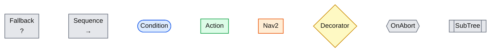
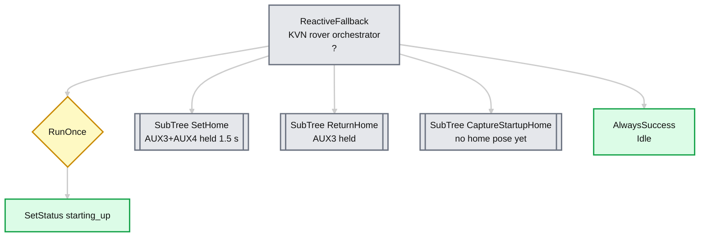
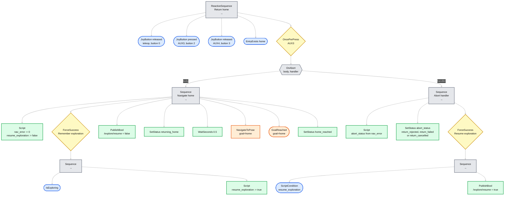

# kvn_orchestrator

A [BehaviorTree.CPP](https://www.behaviortree.dev/) (v4) orchestrator for the rover's autonomous
functions, built on the Nav2 BT API. The behaviour is defined entirely in XML: which subtrees exist,
their priority, and every topic, button index, timeout and threshold. Node implementations are
plugins loaded by name, so adding a new action means writing a plugin and referencing it from XML.

Navigation is done by Nav2's own `NavigateToPose` and `GoalReached` BT plugins
(`nav2_behavior_tree`). The orchestrator is a `nav2::LifecycleNode` that provides the blackboard
entries those plugins expect (`node`, `tf_buffer`, `bt_loop_duration`, timeouts), so any other Nav2
BT plugin (`Spin`, `BackUp`, `Wait`, ...) can be added to `plugin_libraries` and used from XML.

The shipped tree captures a home pose and provides a joystick-triggered Nav2 return-home action.

## Controls and safety

- At startup, the first localized pose is captured as home after `/odom_ekf`
  reports the rover stationary for one second and teleop is disabled.
- Hold AUX3 (`/joy.buttons[2]`) by itself to pause active exploration and navigate
  to home. Releasing AUX3, enabling teleop, or losing fresh Joy messages cancels the Nav2 goal
  (Nav2's BT node waits for Nav2 to confirm the cancellation).
- If exploration was active before return-home, cancelling the return resumes
  exploration. Successfully reaching home leaves exploration paused.
- Hold AUX3+AUX4 (`buttons[2]` and `[3]`) for 1.5 seconds to capture a replacement
  home pose. This is allowed only with teleop disabled and the rover stationary.
- Home is kept in memory (on the blackboard) and captured again after process restart.

## Tree overview

Diagrams of the shipped XML in [`trees/`](trees), using the standard behavior-tree notation. Keep them
in sync when you edit the XML.

| Node type | Symbol | Meaning |
| --- | --- | --- |
| Fallback / Selector | box with `?` | Runs children left to right; succeeds if any child succeeds |
| Sequence | box with `→` | Runs children left to right; succeeds only if all succeed |
| Condition | ellipse | Checks a true/false state |
| Action | box | A task; green, or orange when it is one of Nav2's own plugins |
| Decorator | diamond | Changes the result or timing of its single child |
| `OnAbort` | hexagon | Not standard. Two children: body, then handler if the body fails or is halted |
| `SubTree` | double-bordered box | Not standard. Reference to another tree, expanded in its own diagram |

Symbols follow Colledanchise and Ögren (reference 1). Mermaid has no true ellipse, so conditions
use its closest shape, the stadium.

The reactive variants (`ReactiveFallback`, `ReactiveSequence`) re-check their children every tick,
so a guard going false halts a running child.

### Legend



### Top level (`kvn_orchestrator.xml`)



### `SetHome`


### `CaptureStartupHome`

Same capture fallback as `SetHome`, but it only runs while no home pose exists and has no chord or
latch.


### `ReturnHome`

The guards run every tick. If one goes false while the body is running, `OnAbort` halts the body,
which makes Nav2's node cancel the goal, and then runs the handler.



## Configuration

| What | Where |
| --- | --- |
| Tree shape, priorities, topics, buttons, timeouts, thresholds, status texts | [`trees/`](trees) XML |
| Plugin libraries, tick period, which XML file/tree to run | [`config/orchestrator.yaml`](config/orchestrator.yaml) |
| Settings Nav2's BT nodes read from node parameters (`goal_reached_tol`, timeouts) | [`config/orchestrator.yaml`](config/orchestrator.yaml) |
| Alternative XML at launch | `orchestrator_tree:=/path/to/tree.xml` |

[`trees/kvn_orchestrator.xml`](trees/kvn_orchestrator.xml) is the entry point. It `<include>`s the
subtrees in [`trees/subtrees/`](trees/subtrees) and calls each one with its parameters as
`<SubTree>` attributes, for example:

```xml
<SubTree ID="ReturnHome" _autoremap="true"
         joy_topic="/joy" teleop_buttons="0" return_buttons="2" return_blocking_buttons="3"
         navigate_action="/navigate_to_pose" explore_settle_s="0.5" ... />
```

Subtrees can be nested and reused freely (`<SubTree ID="..."/>`). With `_autoremap="true"` they share
the blackboard, which is how the captured `home` pose travels from the capture subtrees to
`ReturnHome`. Set `tree_id` in the YAML to run a different `<BehaviorTree>` from the file.

If Nav2's action server is not up yet, the node keeps retrying once per second until it is.

Once Nav2 is reachable the tree is validated when the node starts: an unknown node, a missing plugin, or a bad port value
(`joy_timeout_s="-1"`, `buttons="a"`) stops the node with a message naming the offending node.
Edit the XML and restart the node to apply changes.

### Status values

`/orchestrator/status` (transient local) carries the texts set by the `SetStatus` nodes:
`starting_up`, `waiting_for_localization`, `startup_home_captured`, `home_set`, `returning_home`,
`home_reached`, `return_cancelled`, `return_failed` (Nav2 aborted) and `return_rejected`. Rename or add values by
editing the XML.

## Node reference

Standard BehaviorTree.CPP nodes (`ReactiveSequence`, `Fallback`, `Script`, `ForceSuccess`, ...) are
available. The plugins add:

| Plugin library | Node | Kind | Ports |
| --- | --- | --- | --- |
| `kvn_bt_conditions` | `JoyButton` | condition | `topic`=/joy, `buttons` (e.g. `2;3`), `state`=pressed\|released, `hold_s`=0, `timeout_s`=1. Fails when Joy is stale. |
| | `OncePerPress` | decorator | `topic`, `buttons`. Runs its child, then fails until the buttons are released. |
| | `RobotStationary` | condition | `topic`=/odom_ekf, `timeout_s`=0.5, `hold_s`=1, `max_linear_mps`=0.03, `max_angular_rps`=0.05 |
| | `IsExploring` | condition | `topic`=/explore/status |
| | `EntryExists` | condition | `key`: blackboard entry name, e.g. `home` |
| `kvn_bt_actions` | `SetStatus` | action | `topic`=/orchestrator/status, `value`. Latched; repeats are not re-sent. |
| | `PublishBool` | action | `topic`, `value` |
| | `CaptureRobotPose` | action | `parent_frame`=map, `child_frame`=base_link, output `pose`. Fails while the TF is unavailable. |
| `nav2_behavior_tree` | `NavigateToPose` | action | Nav2's node: `goal` (PoseStamped), `server_name`, outputs `error_code_id`, `error_msg`. Halting it cancels the goal and waits for Nav2 to confirm. |
| | `GoalReached` | condition | Nav2's node: `goal`, `robot_base_frame`; tolerance is the `goal_reached_tol` parameter. Used because Nav2 reports a goal preempted by someone else as success. |
| `kvn_bt_control` | `WaitSeconds` | action | `seconds`. Like `Sleep`, but accepts any number so it can be parameterized from a SubTree. |
| | `OnAbort` | control | Two children: body and handler. The handler runs if the body fails or is halted; skipped on success. |

## Writing a plugin

1. Implement a `BT::ConditionNode`, `SyncActionNode`, `StatefulActionNode`, ... and register it with
   `BT_REGISTER_NODES(factory)`. See [`src/plugins/`](src/plugins).
2. Get ROS access through `kvn_orchestrator::get_context(config())` (the `nav2::LifecycleNode`, TF,
   shared subscriptions and publishers). For an action client, derive from
   `nav2_behavior_tree::BtActionNode` instead, like Nav2's own plugins. Implement `Preparable::prepare()` to create subscriptions/publishers
   and validate ports at startup; this also lets latched topics arrive before the first tick.
3. Build it as a shared library with `BT_PLUGIN_EXPORT` defined (see `kvn_add_bt_plugin` in
   [`CMakeLists.txt`](CMakeLists.txt)). Plugins from other packages are listed as `pkg:libname`.
4. Add the library to `plugin_libraries` and use the node in XML.

Everything runs on one single-threaded executor, so nodes need no locking.

## Integration

Install dependencies with `rosdep install --from-paths src --ignore-src -y` (`behaviortree_cpp`,
`nav2_behavior_tree` and `nav2_ros_common` come from the ROS distro). The node is included by
`kvn_robot_bringup/launch/nav_stack.launch.py` (and so by `robot.launch.py` and `kvn-nav.service`) when Nav2 is enabled. Disable it with
`use_orchestrator:=false`; it is not started when `use_nav2:=false`.

## References

1. M. Colledanchise and P. Ögren, *Behavior Trees in Robotics and AI: An Introduction*.
   Chapman & Hall/CRC Artificial Intelligence and Robotics Series, 2018.
   [arXiv:1709.00084](https://arxiv.org/abs/1709.00084)
2. P. Ögren and C. I. Sprague, "Behavior Trees in Robot Control Systems", *Annual Review of
   Control, Robotics, and Autonomous Systems*, vol. 5, 2022.
   [arXiv:2203.13083](https://arxiv.org/abs/2203.13083)
3. [BehaviorTree.CPP](https://www.behaviortree.dev/) documentation, and the
   [Nav2 behavior tree documentation](https://docs.nav2.org/behavior_trees/index.html).
